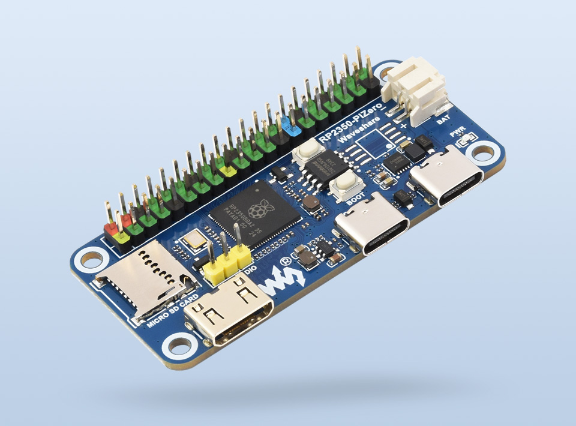
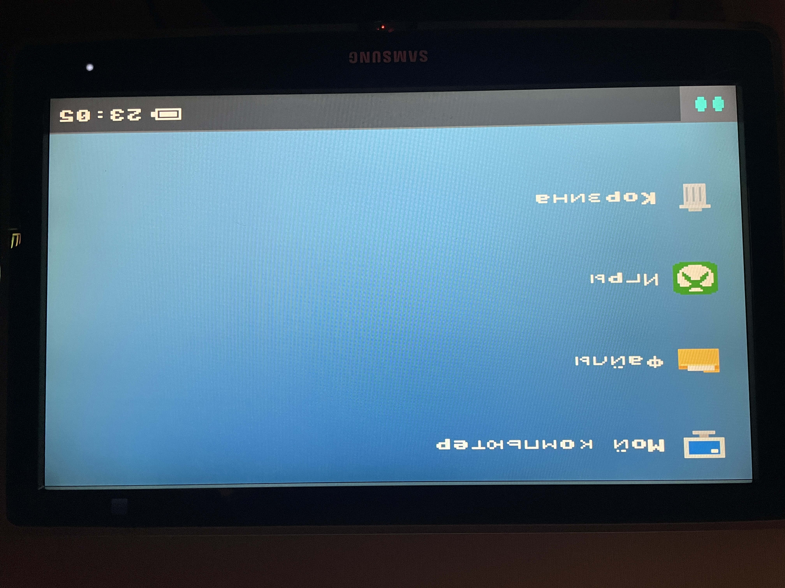
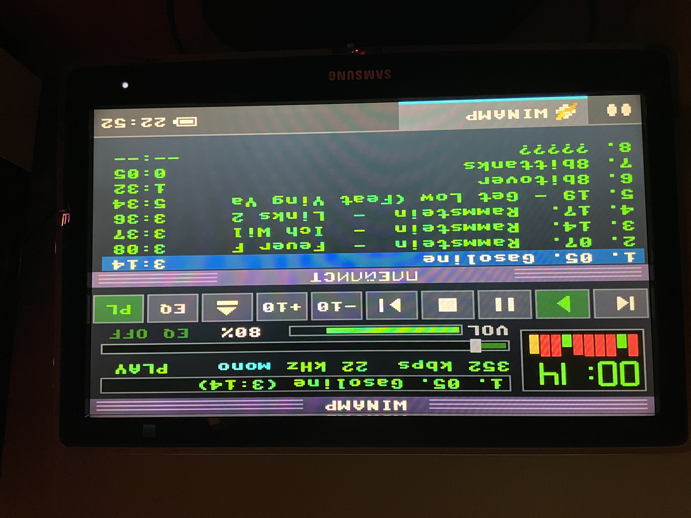
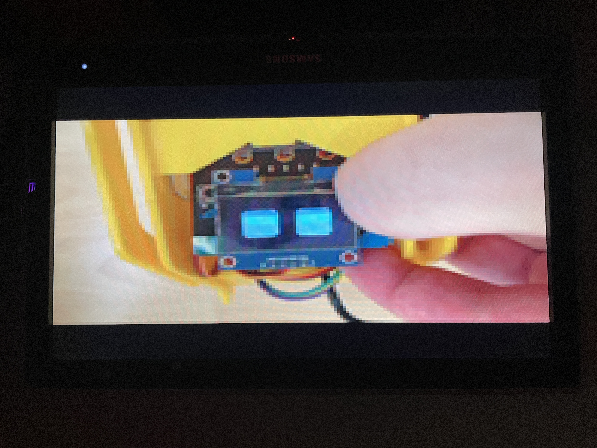

# Waveshare RP2350-PiZero DVI (HDMI) MicroPython Driver

[Русский](#русский) | [English](#english)

---


<p align="center">
  
  
  
  
</p>

<a name="русский"></a>
## 🇷🇺 Русский

Уникальный драйвер DVI/HDMI для платы **Waveshare RP2350-PiZero** под **MicroPython**. 

Драйвер задействует аппаратные возможности микроконтроллера Raspberry Pi **RP2350**, формируя стабильный видеосигнал **640x480 @ 60Hz** (DVI/HDMI) с рабочим разрешением фреймбуфера **320x240** (RGB565 — 65 536 цветов или RGB332 — 256 цветов).

Полная совместимость со стандартной библиотекой MicroPython `framebuf` — вы можете использовать привычные функции рисования (`text`, `line`, `rect`, `fill_rect`, `blit`, `scroll`).

### ⚠️ Лицензия и ограничения на использование
Этот проект распространяется по лицензии **Creative Commons Attribution-NonCommercial-ShareAlike 4.0 (CC BY-NC-SA 4.0)**.
* **РАЗРЕШЕНО:** Личное использование, обучение, хобби-проекты, домашние эксперименты.
* **СТРОГО ЗАПРЕЩЕНО:** Коммерческое использование, предустановка на продаваемые устройства, перепродажа прошивки или её компонентов без согласия автора.

---

### Характеристики
* **Платформа:** Waveshare RP2350-PiZero (чип RP2350).
* **Интерфейс вывода:** Встроенный порт Mini HDMI / DVI.
* **Разрешение монитора:** 640x480 @ 60Hz (стандарт DVI).
* **Разрешение буфера:** 320x240 (удвоение пикселей по X и Y).
* **Глубина цвета:** 
  * 16-бит (RGB565, 65k цветов);
  * 8-бит (RGB332, 256 цветов).
* **Двойная буферизация:** Вывод через `dvi.show()` без тиринга (разрывов кадров).
* **Производительность:** 40–60+ FPS в зависимости от сложности отрисовки.

---

### Быстрый старт

1. **Прошивка микроконтроллера:**
   * Зажмите кнопку **BOOT** на плате и подключите её к ПК через порт **USB** (Type-C).
   * Плата определится как накопитель `RP2350`.
   * Скопируйте файл `firmware/firmware.uf2` из репозитория на накопитель. Плата перезагрузится.

2. **Загрузка драйвера:**
   * С помощью Thonny IDE или другого ПО загрузите файл `driver/dvi_display.py` в корень файловой системы платы (или в папку `/lib`).

3. **Запуск теста:**
   * Откройте и запустите `examples/dvi_test.py` на плате, подключив монитор к разъёму DVI/HDMI.

---

### Пример использования в коде

```python
import time
from dvi_display import DVIDisplay

# Инициализация (320x240, 16-бит RGB565)
tft = DVIDisplay(bpp=16)

# Очистка экрана черным цветом
tft.fill(0)

# Рисование (доступны все методы стандартного framebuf)
color_white = tft.color565(255, 255, 255)
color_red = tft.color565(255, 0, 0)

tft.fill_rect(20, 20, 100, 50, color_red)
tft.text("Hello RP2350 DVI!", 30, 40, color_white)

# Отображение на экране
tft.show()

<a name="english"></a>
## 🇬🇧 English

High-performance DVI/HDMI display driver for the **Waveshare RP2350-PiZero** board running **MicroPython**.

The driver utilizes the hardware capabilities of the **RP2350** microcontroller to generate a rock-solid **640x480 @ 60Hz** digital video stream with an active framebuffer canvas of **320x240** (hardware pixel doubling).

Fully compatible with MicroPython's native `framebuf.FrameBuffer` — you can use all standard drawing functions (`text`, `line`, `rect`, `fill_rect`, `pixel`, `blit`, `scroll`).

### ⚠️ License & Non-Commercial Terms
This project is licensed under **Creative Commons Attribution-NonCommercial-ShareAlike 4.0 (CC BY-NC-SA 4.0)**.
* **ALLOWED:** Personal, educational, and hobbyist non-commercial use.
* **STRICTLY PROHIBITED:** Commercial distribution, pre-installing onto commercial boards or devices, and commercial resale of the firmware without explicit written permission from the author.

---

### Technical Specs
* **Target Hardware:** Waveshare RP2350-PiZero.
* **Interface:** Onboard Mini HDMI connector (DVI mode).
* **Video Standard:** 640x480 @ 60Hz DVI timing.
* **Framebuffer Resolution:** 320x240.
* **Color Modes:** 
  * 16-bit RGB565 (65k colors);
  * 8-bit RGB332 (256 colors).
* **Buffer Swapping:** Tear-free `show()` routine.
* **Frame Rate:** Up to 60 FPS.

---

### Quick Start Guide

1. **Flash Firmware:**
   * Hold the **BOOT** button and plug the board into your PC via USB-C.
   * Copy the `firmware.uf2` firmware to the mounted `RP2350` drive.
2. **Install Python Wrapper:**
   * Upload `dvi_display.py` to the device filesystem (root or `/driver`) using Thonny IDE.
3. **Run Demo:**
   * Connect an HDMI display and execute `dvi_test.py` from examples.

---

### Python Code Example

```python
from dvi_display import DVIDisplay

# Initialize display (320x240, 16-bit RGB565)
tft = DVIDisplay(bpp=16)

# Clear screen with black
tft.fill(0)

# Drawing primitives (standard framebuf API)
white = tft.color565(255, 255, 255)
red = tft.color565(255, 0, 0)

tft.fill_rect(20, 20, 100, 50, red)
tft.text("Hello RP2350 DVI!", 25, 40, white)

# Push frame to display
tft.show()
```

---

### Author & Commercial Inquiries
* **Author:** TurboKirill
